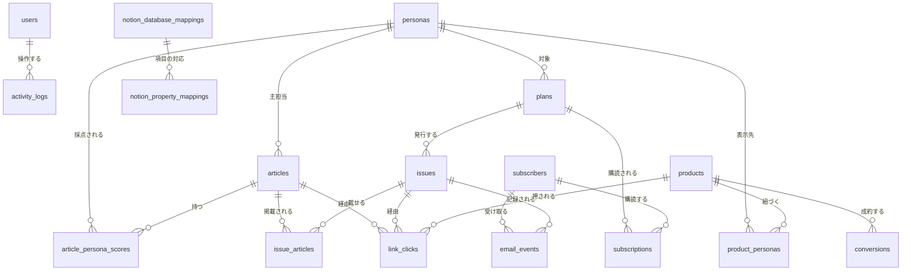

# Persona Wire — データベース設計（たたき台）

本番運用に向けたデータベースの構成案です。改善計画（[SCREENS.md](SCREENS.md) の 8 章）の「H1 サーバーとデータベースを用意する」と「M3 計測」の土台になります。

- 対象: PostgreSQL 15 以上
- 前提: 管理画面のデータの正本はこの DB に置き、Notion には同期した写しを置く
- 状態: たたき台。最後の「10. 決めておくこと」が決まり次第、更新する

---

## 1. 方針

1. **合計値ではなく、出来事を 1 行ずつ記録する。** クリック、成約、メールの開封は、1 回につき 1 行を保存します。「過去30日のクリック」「配信経由の成約」などは、表示するときに集計して出します。今のアプリは合計値（`clicks`、`conversions`、`subscribers`、`openRate`）を固定で持っているため、期間や経路で分けられません。これがこの設計で直したい一番の点です。
2. **データの正本は自前の DB に置く。** Notion は API の速度制限が厳しく、件数の多い記録には向きません。編集・閲覧用の写しとして同期します。
3. **重複を DB の制約で防ぐ。** 記事の URL、ASP の成果 ID などには重複を禁止する制約（`UNIQUE`）を付けます。同じ記事の二重登録や、同じ成果の二重計上を、アプリ側の確認だけに頼らず防ぎます。
4. **消してはいけないデータは消させない。** たとえば有料プランが付いているペルソナは、削除できないようにします（今のアプリの不具合 M5 への対策）。

---

## 2. 全体の関係（ER 図）

GitHub や、Mermaid に対応したエディタで図として表示されます。



---

## 3. テーブル一覧

| 区分 | テーブル | 役割 | 対応する画面 |
|---|---|---|---|
| 共通 | `users` | 管理画面にログインする人（管理者・編集者） | 全画面 |
| | `activity_logs` | 誰がいつ何をしたかの記録 | ダッシュボード |
| ペルソナ | `personas` | 読者像と AI 判定の基準 | ペルソナ |
| 記事 | `articles` | 収集した記事・投稿 | 収集・AI判定、公開サイト |
| | `article_persona_scores` | 記事 × ペルソナごとのスコアと判定理由 | 収集・AI判定 |
| 有料配信 | `plans` | 有料プラン | 有料配信 |
| | `issues` | 配信号 | 有料配信、ダッシュボード |
| | `issue_articles` | 配信号に載せる記事と掲載順 | 有料配信 |
| | `subscribers` | 購読者 | 有料配信 |
| | `subscriptions` | 購読者 × プランの契約 | 有料配信、ダッシュボード |
| | `email_events` | 配信、開封、クリックなどの記録 | 有料配信 |
| 商品 | `products` | アフィリエイト商品・リンク | 商品・リンク |
| | `product_personas` | 商品を表示するペルソナ | 商品・リンク、公開サイト |
| | `link_clicks` | 計測リンクのクリック記録 | 商品・リンク、ダッシュボード |
| | `conversions` | ASP から取り込んだ成約記録 | 商品・リンク |
| Notion | `notion_connections` | 接続情報と同期設定 | Notion連携 |
| | `notion_database_mappings` | アプリのデータ ↔ Notion DB の対応 | Notion連携 |
| | `notion_property_mappings` | 項目 ↔ Notion プロパティの対応 | Notion連携 |
| | `notion_sync_logs` | 同期の記録 | Notion連携 |

---

## 4. 主なテーブルの詳細

すべての表を載せると長くなるため、中心になる表だけを説明します。全定義は「6. SQL」にあります。

### `articles`（記事）

| 列 | 型 | 説明 |
|---|---|---|
| `id` | uuid | 内部 ID |
| `no` | bigint | 画面に出す番号（`#1024`）。自動採番 |
| `type` | text | `news` / `sns`（絞り込み用） |
| `kind` | text | `NEWS` / `YOUTUBE` / `NOTE` / `X` / `THREADS`（表示用） |
| `source_name` | text | 媒体名やアカウント名 |
| `url` | text | 元記事の URL。**重複不可**。`http(s)` で始まるものだけ |
| `status` | text | `pending`（要確認）/ `approved` / `rejected` / `published` |
| `primary_persona_id` | uuid | 主担当ペルソナ。ペルソナが消えたら空にする |
| `verdict` | text | AI 判定 `adopt` / `hold` / `reject` |
| `collected_at` | timestamptz | 収集日時 |

### `article_persona_scores`（適合度スコア）

画面の「article_persona_scores に保存される内容」と同じ名前です。

| 列 | 型 | 説明 |
|---|---|---|
| `article_id` + `persona_id` | uuid | 2 つ合わせて主キー。1 記事 × 1 ペルソナにつき 1 行 |
| `relevance_score` | smallint | 0〜100 |
| `reasons` | text[] | 判定理由のタグ（例: 「筋トレ初心者向け」） |
| `model` | text | 判定に使った AI モデル名。判定のやり直しや比較に使う |

### `link_clicks`（クリック記録）

`/go/<商品ID>` の計測リンクが押されるたびに 1 行を追加します。

| 列 | 型 | 説明 |
|---|---|---|
| `product_id` | uuid | 押された商品 |
| `clicked_at` | timestamptz | 押された日時 |
| `channel` | text | `site`（公開サイト）/ `newsletter`（有料配信） |
| `article_id` / `issue_id` / `persona_id` | uuid | どの記事・配信号・ペルソナのページから押されたか（分かる範囲で） |
| `visitor_hash` | text | 同じ人の連打を見分けるための値。個人情報そのものは保存しない |

### `conversions`（成約記録）

購入はショップのサイトで起きるため、ASP（A8.net、もしもアフィリエイト など）の成果データを取り込みます。

| 列 | 型 | 説明 |
|---|---|---|
| `asp` + `external_id` | text | ASP 名と ASP 側の成果 ID。2 つ合わせて**重複不可**（二重計上の防止） |
| `product_id` | uuid | 対応する商品。突き合わせできない成果もあるため空を許す |
| `sub_id` | text | ASP に渡した媒体識別子。このアプリ経由かどうかの判定に使う |
| `status` | text | `pending`（確定待ち）/ `approved` / `rejected` |
| `commission_yen` | integer | 報酬額 |

---

## 5. 今の型（types.ts）との対応

TypeScript 版の [types.ts](../ts/src/types.ts) から何が変わるかの対応表です。

| 今の型・項目 | DB での扱い | 変える理由 |
|---|---|---|
| `Persona.id`（`'p1'` など） | `personas.id`（uuid）。`code`（`P01`）は表示用に残す | ID を手で付けない |
| `Item` | `articles` | 名前を役割に合わせる |
| `Item.scores` / `Item.reasons` | `article_persona_scores` | ペルソナごとに検索・集計できるようにする |
| `Item.persona` | `articles.primary_persona_id` | — |
| `Delivery` | `plans` | — |
| `Delivery.subscribers` / `openRate` | `subscriptions` と `email_events` から集計 | 固定値をやめる |
| `Issue.itemIds`（配列） | `issue_articles`（掲載順 `position` 付き） | 並び順と重複を DB で守る |
| `Product.personaIds`（配列） | `product_personas` | ペルソナ別の集計をしやすくする |
| `Product.clicks` / `conversions` | `link_clicks` と `conversions` から集計 | 期間・経路別に出せるようにする |
| `NotionState.token` | DB には保存しない。サーバーの秘密情報の保管場所に置き、DB には参照名だけを持つ | 漏えい対策 |
| `NotionState` のその他 | `notion_connections` ほか 3 表 | — |
| `Activity` | `activity_logs`（実行した人付き） | 誰の操作かを残す |
| `DailyStat` | 保存しない。`articles` から集計 | 固定値をやめる |

---

## 6. SQL（PostgreSQL）

そのまま実行できる定義です。`updated_at` の自動更新は、アプリ側で行う前提です。

```sql
-- ========== 共通 ==========
CREATE TABLE users (
  id          uuid PRIMARY KEY DEFAULT gen_random_uuid(),
  email       text NOT NULL UNIQUE,
  name        text NOT NULL,
  role        text NOT NULL DEFAULT 'editor' CHECK (role IN ('admin', 'editor')),
  created_at  timestamptz NOT NULL DEFAULT now()
);

CREATE TABLE activity_logs (
  id           bigint GENERATED ALWAYS AS IDENTITY PRIMARY KEY,
  user_id      uuid REFERENCES users(id) ON DELETE SET NULL,
  action       text NOT NULL,              -- 例: article.publish, issue.send
  target_type  text,
  target_id    text,
  detail       jsonb NOT NULL DEFAULT '{}',
  created_at   timestamptz NOT NULL DEFAULT now()
);
CREATE INDEX activity_logs_created_idx ON activity_logs (created_at DESC);

-- ========== ペルソナ ==========
CREATE TABLE personas (
  id           uuid PRIMARY KEY DEFAULT gen_random_uuid(),
  code         text NOT NULL UNIQUE,       -- 表示用 P01
  name         text NOT NULL,
  handle       text NOT NULL UNIQUE,       -- 公開URLのスラッグ
  color        text NOT NULL DEFAULT '#888888',
  description  text NOT NULL DEFAULT '',
  keywords     text[] NOT NULL DEFAULT '{}',
  ng_words     text[] NOT NULL DEFAULT '{}',
  tone         text NOT NULL DEFAULT '',
  threshold    smallint NOT NULL DEFAULT 70 CHECK (threshold BETWEEN 0 AND 100),
  active       boolean NOT NULL DEFAULT true,
  created_at   timestamptz NOT NULL DEFAULT now(),
  updated_at   timestamptz NOT NULL DEFAULT now()
);

-- ========== 記事 ==========
CREATE TABLE articles (
  id                  uuid PRIMARY KEY DEFAULT gen_random_uuid(),
  no                  bigint GENERATED ALWAYS AS IDENTITY UNIQUE,
  type                text NOT NULL CHECK (type IN ('news', 'sns')),
  kind                text NOT NULL CHECK (kind IN ('NEWS', 'YOUTUBE', 'NOTE', 'X', 'THREADS')),
  source_name         text NOT NULL,
  category            text NOT NULL DEFAULT '',
  title               text NOT NULL,
  excerpt             text NOT NULL DEFAULT '',
  url                 text NOT NULL UNIQUE CHECK (url ~ '^https?://'),
  collected_at        timestamptz NOT NULL DEFAULT now(),
  status              text NOT NULL DEFAULT 'pending'
                        CHECK (status IN ('pending', 'approved', 'rejected', 'published')),
  primary_persona_id  uuid REFERENCES personas(id) ON DELETE SET NULL,
  verdict             text CHECK (verdict IN ('adopt', 'hold', 'reject')),
  editor_comment      text NOT NULL DEFAULT '',
  notion_db           text NOT NULL DEFAULT 'articles'
                        CHECK (notion_db IN ('articles', 'sns_posts', 'ideas')),
  notion_page_id      text UNIQUE,
  published_at        timestamptz,
  created_at          timestamptz NOT NULL DEFAULT now(),
  updated_at          timestamptz NOT NULL DEFAULT now()
);
CREATE INDEX articles_status_collected_idx ON articles (status, collected_at DESC);
CREATE INDEX articles_persona_idx ON articles (primary_persona_id);

CREATE TABLE article_persona_scores (
  article_id       uuid NOT NULL REFERENCES articles(id) ON DELETE CASCADE,
  persona_id       uuid NOT NULL REFERENCES personas(id) ON DELETE CASCADE,
  relevance_score  smallint NOT NULL CHECK (relevance_score BETWEEN 0 AND 100),
  reasons          text[] NOT NULL DEFAULT '{}',
  model            text,
  judged_at        timestamptz NOT NULL DEFAULT now(),
  PRIMARY KEY (article_id, persona_id)
);
CREATE INDEX article_persona_scores_persona_idx
  ON article_persona_scores (persona_id, relevance_score DESC);

-- ========== 有料配信 ==========
CREATE TABLE plans (
  id          uuid PRIMARY KEY DEFAULT gen_random_uuid(),
  name        text NOT NULL,
  persona_id  uuid NOT NULL REFERENCES personas(id) ON DELETE RESTRICT,  -- プランがあるペルソナは削除不可
  price_yen   integer NOT NULL CHECK (price_yen >= 0),
  channel     text NOT NULL CHECK (channel IN ('email', 'line', 'discord', 'note')),
  cadence     text NOT NULL DEFAULT '',
  status      text NOT NULL DEFAULT 'active' CHECK (status IN ('active', 'paused')),
  created_at  timestamptz NOT NULL DEFAULT now()
);

CREATE TABLE issues (
  id            uuid PRIMARY KEY DEFAULT gen_random_uuid(),
  plan_id       uuid NOT NULL REFERENCES plans(id) ON DELETE CASCADE,
  no            integer NOT NULL,
  title         text NOT NULL,
  intro         text NOT NULL DEFAULT '',
  status        text NOT NULL DEFAULT 'draft' CHECK (status IN ('draft', 'scheduled', 'sent')),
  scheduled_at  timestamptz,
  sent_at       timestamptz,
  created_at    timestamptz NOT NULL DEFAULT now(),
  UNIQUE (plan_id, no),
  CHECK (status <> 'sent' OR sent_at IS NOT NULL)
);
CREATE INDEX issues_schedule_idx ON issues (status, scheduled_at);

CREATE TABLE issue_articles (
  issue_id    uuid NOT NULL REFERENCES issues(id) ON DELETE CASCADE,
  article_id  uuid NOT NULL REFERENCES articles(id) ON DELETE RESTRICT,
  position    smallint NOT NULL,
  PRIMARY KEY (issue_id, article_id),
  UNIQUE (issue_id, position) DEFERRABLE INITIALLY DEFERRED  -- 並べ替えのとき一時的な重複を許す
);

CREATE TABLE subscribers (
  id            uuid PRIMARY KEY DEFAULT gen_random_uuid(),
  email         text UNIQUE,
  line_user_id  text UNIQUE,
  created_at    timestamptz NOT NULL DEFAULT now(),
  CHECK (email IS NOT NULL OR line_user_id IS NOT NULL)
);

CREATE TABLE subscriptions (
  id                      uuid PRIMARY KEY DEFAULT gen_random_uuid(),
  subscriber_id           uuid NOT NULL REFERENCES subscribers(id) ON DELETE CASCADE,
  plan_id                 uuid NOT NULL REFERENCES plans(id) ON DELETE RESTRICT,
  status                  text NOT NULL CHECK (status IN ('active', 'past_due', 'canceled')),
  started_at              timestamptz NOT NULL DEFAULT now(),
  canceled_at             timestamptz,
  stripe_subscription_id  text UNIQUE
);
CREATE INDEX subscriptions_plan_status_idx ON subscriptions (plan_id, status);

CREATE TABLE email_events (
  id             bigint GENERATED ALWAYS AS IDENTITY PRIMARY KEY,
  issue_id       uuid NOT NULL REFERENCES issues(id) ON DELETE CASCADE,
  subscriber_id  uuid REFERENCES subscribers(id) ON DELETE SET NULL,
  event_type     text NOT NULL CHECK (event_type IN ('sent', 'delivered', 'opened', 'clicked', 'bounced')),
  occurred_at    timestamptz NOT NULL DEFAULT now()
);
CREATE INDEX email_events_issue_idx ON email_events (issue_id, event_type);

-- ========== 商品・リンク ==========
CREATE TABLE products (
  id          uuid PRIMARY KEY DEFAULT gen_random_uuid(),
  name        text NOT NULL,
  category    text NOT NULL DEFAULT '',
  url         text NOT NULL CHECK (url ~ '^https?://'),
  price_yen   integer NOT NULL DEFAULT 0 CHECK (price_yen >= 0),
  asp         text,                         -- 例: a8, moshimo, amazon
  active      boolean NOT NULL DEFAULT true,
  created_at  timestamptz NOT NULL DEFAULT now()
);

CREATE TABLE product_personas (
  product_id  uuid NOT NULL REFERENCES products(id) ON DELETE CASCADE,
  persona_id  uuid NOT NULL REFERENCES personas(id) ON DELETE CASCADE,
  PRIMARY KEY (product_id, persona_id)
);

CREATE TABLE link_clicks (
  id            bigint GENERATED ALWAYS AS IDENTITY PRIMARY KEY,
  product_id    uuid NOT NULL REFERENCES products(id) ON DELETE CASCADE,
  clicked_at    timestamptz NOT NULL DEFAULT now(),
  channel       text NOT NULL CHECK (channel IN ('site', 'newsletter')),
  article_id    uuid REFERENCES articles(id) ON DELETE SET NULL,
  issue_id      uuid REFERENCES issues(id) ON DELETE SET NULL,
  persona_id    uuid REFERENCES personas(id) ON DELETE SET NULL,
  visitor_hash  text
);
CREATE INDEX link_clicks_product_time_idx ON link_clicks (product_id, clicked_at DESC);

CREATE TABLE conversions (
  id               bigint GENERATED ALWAYS AS IDENTITY PRIMARY KEY,
  asp              text NOT NULL,
  external_id      text NOT NULL,
  product_id       uuid REFERENCES products(id) ON DELETE SET NULL,
  sub_id           text,
  status           text NOT NULL DEFAULT 'pending' CHECK (status IN ('pending', 'approved', 'rejected')),
  sale_amount_yen  integer,
  commission_yen   integer,
  occurred_at      timestamptz NOT NULL,
  imported_at      timestamptz NOT NULL DEFAULT now(),
  UNIQUE (asp, external_id)
);
CREATE INDEX conversions_product_time_idx ON conversions (product_id, occurred_at DESC);

-- ========== Notion 連携 ==========
CREATE TABLE notion_connections (
  id                uuid PRIMARY KEY DEFAULT gen_random_uuid(),
  workspace_name    text NOT NULL,
  token_secret_ref  text NOT NULL,          -- トークン本体ではなく、秘密情報の保管場所での参照名
  auto_sync         boolean NOT NULL DEFAULT true,
  interval_minutes  integer NOT NULL DEFAULT 30 CHECK (interval_minutes >= 5),
  last_synced_at    timestamptz,
  created_at        timestamptz NOT NULL DEFAULT now()
);

CREATE TABLE notion_database_mappings (
  key                 text PRIMARY KEY CHECK (key IN ('articles', 'scores', 'personas', 'issues', 'products')),
  label               text NOT NULL,
  notion_database_id  text,
  direction           text NOT NULL DEFAULT 'both' CHECK (direction IN ('both', 'push', 'pull')),
  enabled             boolean NOT NULL DEFAULT true
);

CREATE TABLE notion_property_mappings (
  id               bigint GENERATED ALWAYS AS IDENTITY PRIMARY KEY,
  database_key     text NOT NULL REFERENCES notion_database_mappings(key) ON DELETE CASCADE,
  field            text NOT NULL,
  notion_property  text NOT NULL,
  notion_type      text NOT NULL,
  UNIQUE (database_key, field)
);

CREATE TABLE notion_sync_logs (
  id           bigint GENERATED ALWAYS AS IDENTITY PRIMARY KEY,
  started_at   timestamptz NOT NULL DEFAULT now(),
  finished_at  timestamptz,
  ok           boolean,
  message      text NOT NULL DEFAULT ''
);
```

---

## 7. 画面の数字の出し方（集計クエリ）

今は固定値の数字を、DB からどう計算するかの例です。

**商品・リンク：過去30日のクリック・成約・CVR（商品ごと）**
```sql
SELECT p.id, p.name,
       count(DISTINCT c.id)  AS clicks_30d,
       count(DISTINCT cv.id) AS conversions_30d,
       round(100.0 * count(DISTINCT cv.id) / NULLIF(count(DISTINCT c.id), 0), 1) AS cvr
FROM products p
LEFT JOIN link_clicks c  ON c.product_id = p.id  AND c.clicked_at  >= now() - interval '30 days'
LEFT JOIN conversions cv ON cv.product_id = p.id AND cv.occurred_at >= now() - interval '30 days'
                        AND cv.status <> 'rejected'
GROUP BY p.id, p.name;
```

**有料配信・ダッシュボード：購読者数と月間売上（MRR）**
```sql
SELECT pl.id, pl.name,
       count(s.id)                AS subscribers,
       count(s.id) * pl.price_yen AS mrr_yen
FROM plans pl
LEFT JOIN subscriptions s ON s.plan_id = pl.id AND s.status = 'active'
GROUP BY pl.id, pl.name, pl.price_yen;
```

**有料配信：配信号ごとの開封率**
```sql
SELECT issue_id,
       round(100.0 * count(DISTINCT subscriber_id) FILTER (WHERE event_type = 'opened')
             / NULLIF(count(DISTINCT subscriber_id) FILTER (WHERE event_type = 'delivered'), 0), 1) AS open_rate
FROM email_events
GROUP BY issue_id;
```

**ダッシュボード：直近7日の収集と採用（日別）**
```sql
SELECT date_trunc('day', collected_at AT TIME ZONE 'Asia/Tokyo') AS day,
       count(*) FILTER (WHERE type = 'news')       AS news,
       count(*) FILTER (WHERE type = 'sns')        AS sns,
       count(*) FILTER (WHERE verdict = 'adopt')   AS adopted
FROM articles
WHERE collected_at >= now() - interval '7 days'
GROUP BY 1
ORDER BY 1;
```

---

## 8. Notion との関係

- **正本は DB。** Notion には同期した写しを置きます。
- **どの行がどの Notion ページかを記録する。** `articles.notion_page_id` に Notion 側のページ ID を保存し、更新のたびにページを新しく作らないようにします。ほかの表も、同期するなら同じ列を足します。
- **同期方向は `notion_database_mappings.direction` で決める。** `both` の場合、両方で同じ項目が変わったときにどちらを優先するか（「後から更新した方」など）を決めておく必要があります。
- **トークンは DB に入れない。** サーバーの秘密情報の保管場所（クラウドの Secret Manager など）に置き、DB には参照名だけを持ちます。

---

## 9. 作る順番

| 段階 | 作るテーブル | これでできるようになること |
|---|---|---|
| 1 | `users`、`activity_logs`、`personas`、`articles`、`article_persona_scores` | ログインして、収集・AI判定と公開を本物のデータで回す |
| 2 | `plans`、`issues`、`issue_articles` | 配信号の編集と予約を DB に保存する |
| 3 | `products`、`product_personas`、`link_clicks`、`conversions` | クリック・成約を記録し、「過去30日」を本物の数字にする |
| 4 | `subscribers`、`subscriptions`、`email_events` | 決済・配信サービスとつなぎ、購読者数・売上・開封率を本物にする |
| 5 | Notion の 4 表 | Notion と本当に同期する |

---

## 10. 決めておくこと

| # | 決めること | 影響する表 |
|---|---|---|
| 1 | DB をどこで動かすか（Supabase、Neon、Cloud SQL など） | 全体 |
| 2 | ログインの方法（メール + パスワード、Google ログインなど） | `users` |
| 3 | 使う ASP と、成果データの取り込み方法（API・CSV）、サブ ID で媒体を見分けられるか | `conversions` |
| 4 | 決済サービス（Stripe など）と、LINE での配信をするか | `subscriptions`、`subscribers` |
| 5 | メール配信サービス（開封の記録が取れるか） | `email_events` |
| 6 | 同じ人の連打をどう数えるか（数秒以内は 1 回とする、など） | `link_clicks` |
| 7 | 記録をどれだけの期間残すか（例: クリックは 2 年で集計値だけ残す） | `link_clicks`、`email_events` |
| 8 | Notion で双方向に編集したとき、どちらを優先するか | Notion の各表 |
